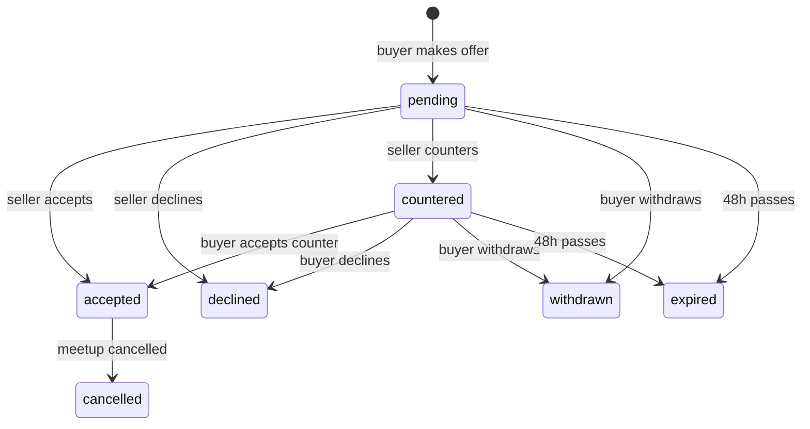

# ♻️ ResellRing — Campus Second-Hand Marketplace

> Buy and sell used stuff with people on your campus. Make offers, haggle, agree on a meetup spot, and see what things *actually* sell for.

| | |
|---|---|
| **Live app** | `https://resellring.vercel.app` |
| **Demo video** | `https://drive.google.com/file/d/13KCLYrMg8qUsawBrHqfxcu6MUEYtLLSA/view?usp=sharing` |
| **Student** | `Riddhima Jaiswal` |

---

## 1. Problem Statement

Every semester, students throw away or undersell perfectly good items: textbooks, cycles, lab coats, hostel furniture, calculators. The usual options are poor:

- **WhatsApp / Telegram groups** bury listings in chat noise. There is no search, no status, and no way to tell if something is already sold.
- **General marketplaces (OLX, Facebook)** mean strangers, scams and long-distance meetups, so they aren't built for a single campus.
- **Nobody knows a fair price.** Sellers guess, buyers lowball, and negotiation turns into endless back-and-forth messages.

## 2. Target Users

- **Sellers**: students (especially graduating seniors) who want to clear out items quickly and for a fair price.
- **Buyers**: juniors and freshers who need affordable books, cycles, electronics and room essentials.
- Access is restricted to **verified campus email addresses**, so every counterpart is a real student from the same college.

## 3. Solution

ResellRing turns a messy chat-based process into a structured workflow:

```
Post item → Buyer makes offer → Seller accepts / declines / counters
          → Item reserved → Agree meetup time & place
          → Both confirm handover → Sold price recorded → Buyer rates seller
```

Each step is enforced by the server. You can't skip steps, offer on your own item, double-sell an item, or rate a seller you never bought from.

## 4. Key Features

### Listings
- Post items with up to 4 photos, category, condition and asking price
- Search by keyword and filter by category, condition and price range, with sorting and pagination
- Edit details or delete your own listings while they are still active

### Offer → Accept / Decline / Counter workflow
- Buyers make an offer with an optional message
- Sellers can **accept**, **decline** or **counter**; buyers can **withdraw**, or accept or decline a counter
- Offers **auto-expire after 48 hours**
- Accepting an offer **reserves** the item and **automatically declines all other pending offers**
- An in-app **badge** shows how many offers need your response

### Meetup coordination
- After acceptance, either party proposes a **campus location** (library, canteen, main gate…) and a **time**
- The other party agrees, or counter-proposes by proposing a new slot
- Both confirm the handover; only then is the item marked **sold**
- If the deal falls through, cancelling puts the item back on sale

### Seller ratings
- Only the **buyer of a completed transaction** can rate the seller (1–5 stars + comment), **once per transaction**
- Seller profiles show their average rating and review history

### Sold-price history
- Every completed sale records the real final price
- A price-history page shows average, minimum and maximum sold prices per category, the average discount from asking price, and a feed of recent sales
- Helps both sides price fairly *before* negotiating

## 5. Tech Stack (MERN)

| Layer | Technology |
|---|---|
| Database | MongoDB Atlas + Mongoose |
| Backend | Node.js, Express 4 |
| Frontend | React (Vite), React Router |
| Auth | JWT + bcrypt |
| Validation | Zod |
| Images | Multer + Cloudinary (local-disk fallback for dev) |
| Security middleware | Helmet, CORS allow-list, express-rate-limit |
| Hosting | Vercel (client), Render (server), Atlas (DB) |

## 6. Architecture

```
┌───────────────┐   HTTPS / JSON    ┌──────────────────────────────┐      ┌──────────────┐
│  React (Vite) │ ────────────────▶ │  Express API                 │ ───▶ │ MongoDB Atlas│
│  Auth context │   JWT Bearer      │  routes → validation (Zod)   │      └──────────────┘
│  API client   │ ◀──────────────── │  → services (business logic) │ ───▶ ┌──────────────┐
└───────────────┘                   │  → models (Mongoose)         │      │  Cloudinary  │
                                    └──────────────────────────────┘      └──────────────┘
```

**Layering:** routes handle HTTP and validation only. All business rules live in `services/offerService.js`. Models define data and indexes. A central error handler turns every failure into a consistent JSON response.

### Offer state machine



Any transition not in this diagram is rejected with **HTTP 409**. The wrong user attempting a valid transition gets **HTTP 403**.

### Concurrency & integrity decisions

| Problem | How it's solved |
|---|---|
| Two sellers' accepts racing on one item | Accept uses a conditional update (`findOneAndUpdate` with `status: "active"`), so only one can reserve the listing |
| Duplicate offers from the same buyer | Partial unique index on `(listing, buyer)` where the offer is open, enforced by the database rather than just app code |
| Stale offer actions (double-clicks, two tabs) | Offer updates are guarded on the status the server last read; a mismatch returns 409 |
| Double ratings | Unique index on `(offer, rater)` |
| Fake ratings | Rating requires a completed meetup on that offer, and only the buyer can rate |
| Drifting average rating | Recomputed from the `Rating` collection with an aggregation after each new rating |

### Data model

| Collection | Key fields |
|---|---|
| **User** | name, email (unique), passwordHash, ratingAvg, ratingCount |
| **Listing** | seller, title, description, category, condition, askingPrice, images[], status (`active/reserved/sold`), reservedOffer, soldPrice, soldAt |
| **Offer** | listing, buyer, seller, amount, counterAmount, finalAmount, message, status, isOpen, expiresAt |
| **Meetup** | offer (unique), listing, buyer, seller, location, proposedTime, proposedBy, status, buyerConfirmed, sellerConfirmed |
| **Rating** | offer, rater, ratee, stars, comment |

## 7. API Reference

All routes are prefixed with `/api`. 🔒 means `Authorization: Bearer <token>` is required.

| Method | Route | Description |
|---|---|---|
| POST | `/auth/register` | Create account (campus email required) |
| POST | `/auth/login` | Log in, returns JWT |
| GET 🔒 | `/auth/me` | Current user |
| GET | `/listings` | Search and filter (`q, category, condition, minPrice, maxPrice, seller, status, sort, page, limit`) |
| GET | `/listings/:id` | Listing detail |
| POST 🔒 | `/listings` | Create listing (multipart, up to 4 images) |
| PATCH 🔒 | `/listings/:id` | Edit own active listing |
| DELETE 🔒 | `/listings/:id` | Delete own active listing (declines open offers) |
| POST 🔒 | `/offers` | Make an offer |
| GET 🔒 | `/offers/mine?role=buyer\|seller` | My offers, with meetup and rated flag |
| GET 🔒 | `/offers/badge` | Count of offers needing my response |
| GET 🔒 | `/offers/listing/:listingId` | Offers on my listing (seller only) |
| POST 🔒 | `/offers/:id/accept` · `/decline` · `/withdraw` | Respond to an offer |
| POST 🔒 | `/offers/:id/counter` | Seller counters with `counterAmount` |
| POST 🔒 | `/meetups` | Propose or re-propose location and time |
| GET 🔒 | `/meetups/by-offer/:offerId` | Meetup for an offer |
| POST 🔒 | `/meetups/:id/agree` | Other party agrees to the proposal |
| POST 🔒 | `/meetups/:id/confirm-handover` | Confirm the item changed hands |
| POST 🔒 | `/meetups/:id/cancel` | Cancel deal, relist item |
| POST 🔒 | `/ratings` | Rate a seller after a completed handover |
| GET | `/ratings/user/:userId` | A user's rating profile |
| GET | `/stats/price-history` | Sold-price analytics (`category`, `q`) |
| GET | `/stats/meta` | Categories, conditions, campus locations |

## 8. Security

- Passwords hashed with **bcrypt**; never stored or returned in plain text
- **JWT** authentication; every private route is behind `requireAuth`
- **Authorization** checks on every resource: only the seller can accept, only the buyer can withdraw or rate, only participants can touch a meetup, and only the owner can edit a listing
- **Zod validation** on bodies and query strings; regex search input is escaped to prevent ReDoS and injection
- **Helmet** headers, a **CORS allow-list**, and **rate limiting** on auth routes
- Upload filter allows JPG, PNG and WebP only, max 5 MB each and 4 files
- Secrets live only in environment variables; `.env` is git-ignored

## 9. Error Handling

| Situation | Response |
|---|---|
| Invalid input | `400` with field-level messages |
| Not logged in / expired token | `401` |
| Acting on someone else's resource | `403` |
| Missing listing / offer / meetup | `404` |
| Invalid state change, duplicate offer, item already reserved, double rating | `409` |
| Image storage failure | `502` with a retry message |
| Anything unexpected | `500` generic message (details only in server logs) |

The client shows loading, empty, success and error states for each of these.

## 10. Local Setup

**Prerequisites:** Node 18+, a MongoDB Atlas cluster (or local MongoDB).

```bash
# 1. Clone
git clone <your-repo-url> && cd resellring

# 2. Server
cd server
cp .env.example .env        # then fill in values
npm install
npm run seed                 # optional: load demo data (WIPES the database in MONGODB_URI)
npm run dev                  # http://localhost:5000

# 3. Client (new terminal)
cd client
cp .env.example .env
npm install
npm run dev                  # http://localhost:5173
```

> **Port note:** the API defaults to `5000`. On macOS, AirPlay Receiver uses that port; if you get `EADDRINUSE`, set `PORT=5001` in `server/.env` and `VITE_API_URL=http://localhost:5001` in `client/.env`. In production the server reads `PORT` from the host automatically.

### Tests

```bash
cd server && npm test
```
Unit tests cover the offer state machine: every legal transition, wrong-role attempts (403), illegal moves and terminal states (409).

### Demo data

`npm run seed` (in `server/`) fills the database with 5 students, 12 active listings, 15 completed sales (so the **Sold prices** page and seller ratings are populated) and a few deals mid-way through the workflow. All accounts use the password **`Password123!`**; emails use the first domain in `ALLOWED_EMAIL_DOMAINS` (default `college.edu`).

| Log in as | What you'll see |
|---|---|
| `aarav@college.edu` | Two pending offers and one counter on his listings: try accept / decline / counter |
| `rohan@college.edu` | Has a counter-offer waiting for his response, and a reserved racket sale |
| `karthik@college.edu` | A reserved study table: agree to the proposed meetup |
| `priya@college.edu` | A buyer: browse, filter and make an offer |

The seed script refuses to run when `NODE_ENV=production` unless `FORCE_SEED=1` is set.

### Environment variables

**`server/.env`**

| Variable | Description |
|---|---|
| `PORT` | API port (default 5000) |
| `MONGODB_URI` | MongoDB connection string |
| `JWT_SECRET` | Long random string for signing tokens |
| `CLIENT_URL` | Allowed frontend origin(s), comma-separated |
| `ALLOWED_EMAIL_DOMAINS` | Campus email domains, e.g. `college.edu`. Leave empty to allow any email (dev only) |
| `CLOUDINARY_CLOUD_NAME` / `_API_KEY` / `_API_SECRET` | Optional. If unset, images go to local `server/uploads/` |

**`client/.env`**

| Variable | Description |
|---|---|
| `VITE_API_URL` | Base URL of the API, e.g. `http://localhost:5000` |

## 11. Deployment

| Part | Platform | Notes |
|---|---|---|
| Database | MongoDB Atlas | Allow Render's IPs (or `0.0.0.0/0` for a student project) in Network Access |
| Server | Render (Web Service) | Root `server`, build `npm install`, start `npm start`, add all server env vars. Set Cloudinary keys, because Render's disk is ephemeral |
| Client | Vercel | Root `client`, framework Vite, set `VITE_API_URL` to the Render URL. Add a rewrite of all paths to `/index.html` for client-side routing |

A `render.yaml` blueprint is included (Render → New → Blueprint) that pre-fills the service settings and generates `JWT_SECRET`; you only add the secrets marked `sync: false`.

After deploying, set `CLIENT_URL` on Render to the Vercel URL. Note that Render's free tier sleeps after inactivity, so the first request can take about 30 seconds.

## 12. Project Structure

```
resellring/
├── client/                 # React (Vite) frontend
│   └── src/
│       ├── api/            # fetch wrapper + per-resource API functions
│       ├── context/        # AuthContext (token, user, login/logout)
│       ├── components/     # ListingCard, OfferBox, MeetupPanel, RatingForm, ...
│       └── pages/          # Browse, ListingDetail, NewListing, EditListing, MyDeals, PriceHistory, Profile, Login
├── server/
│   └── src/
│       ├── config/         # database connection
│       ├── models/         # User, Listing, Offer, Meetup, Rating
│       ├── routes/         # auth, listings, offers, meetups, ratings, stats
│       ├── services/       # offerService (state machine), upload (Cloudinary/local)
│       ├── middleware/     # auth, validate, error handler
│       ├── utils/          # AppError, asyncHandler
│       ├── constants.js    # categories, conditions, campus locations
│       ├── app.js          # Express app
│       ├── seed.js         # demo data (npm run seed)
│       └── server.js       # entry point
└── README.md
```

## 13. Design Decisions & Trade-offs

- **Why a state machine?** Negotiation is the heart of the product. Encoding it as explicit transitions makes illegal states impossible, and every rule is testable in one file.
- **Why conditional updates instead of only transactions?** They give the same guarantee for the critical race (two accepts) and work on any MongoDB deployment, with no replica-set requirement.
- **Why lazy offer expiry?** Expiry is applied whenever offers are read or acted on, so there is no cron job to keep alive on a free hosting tier.
- **Why no chat or payments?** Meetup coordination and cash-on-handover fit campus reality. Depth in the core workflow was prioritised over breadth.
- **Handover confirmation** can be done as soon as a meetup is agreed, without waiting for the meetup time, which keeps the flow demoable.

## 14. Known Limitations & Future Work

- Real-time notifications (WebSockets or push); currently an in-app badge polled on navigation
- In-app chat between buyer and seller
- Reporting, moderation and an admin role
- Wishlists and "notify me when listed"
- Integration tests that run the whole offer-to-rating flow against a test database (unit tests for the state machine already exist)
- Changing photos when editing a listing

## 15. AI Usage & Originality

AI tools were used as an engineering assistant for design discussion, code generation and documentation. The architecture, workflows and business rules were reviewed, run and tested by the author. This is an original project and not based on an existing open-source marketplace. Open-source libraries are used under their own licences.

## 16. Deployed link

**Live app:** [https://resellring.vercel.app](https://resellring.vercel.app/)
